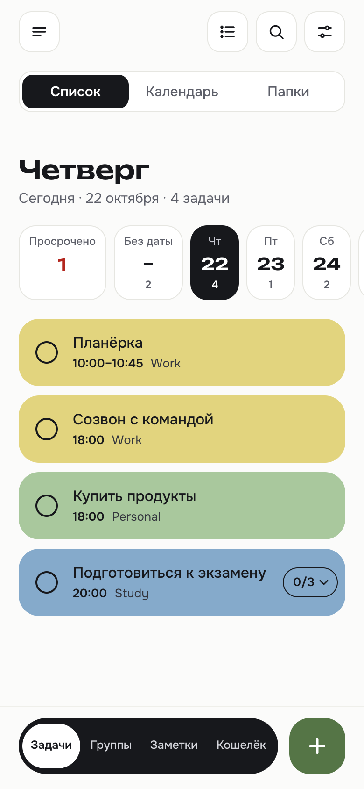
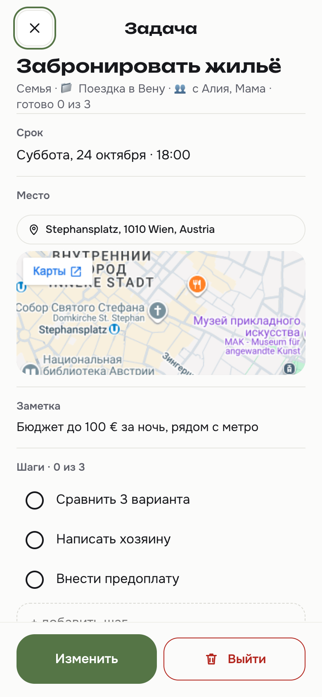
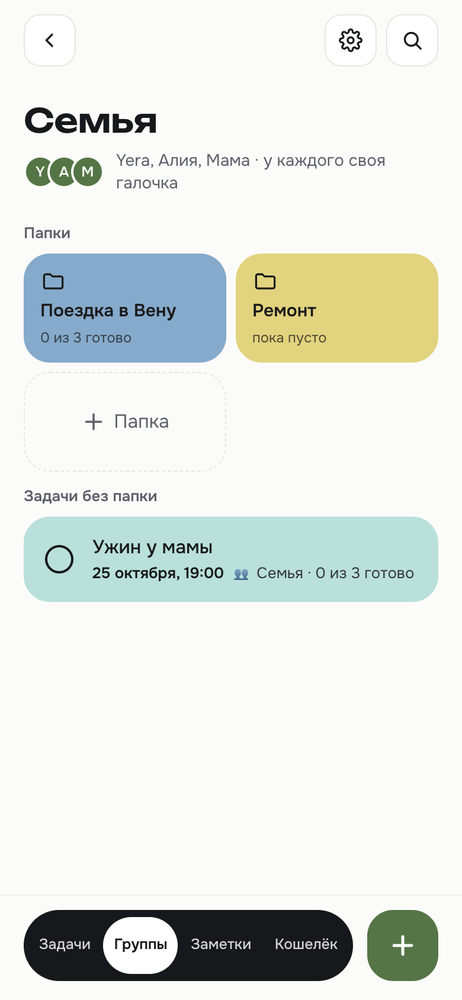
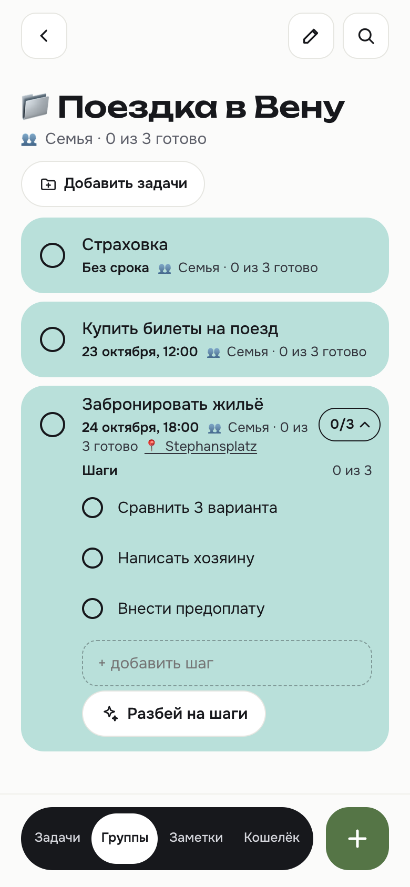
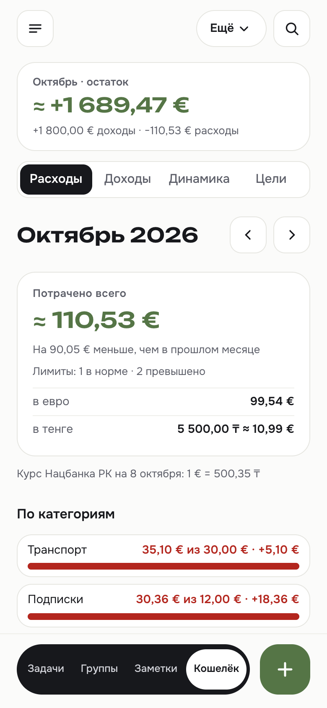
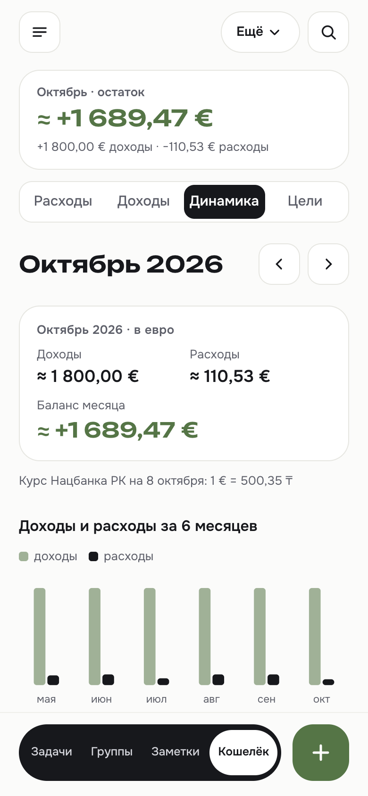
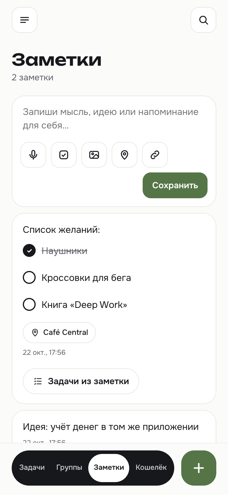
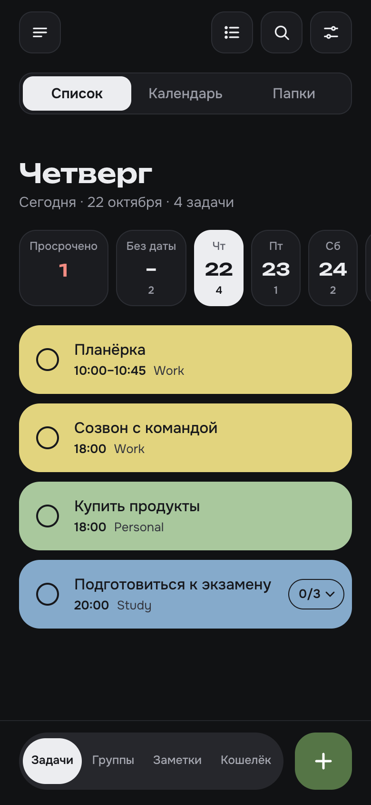
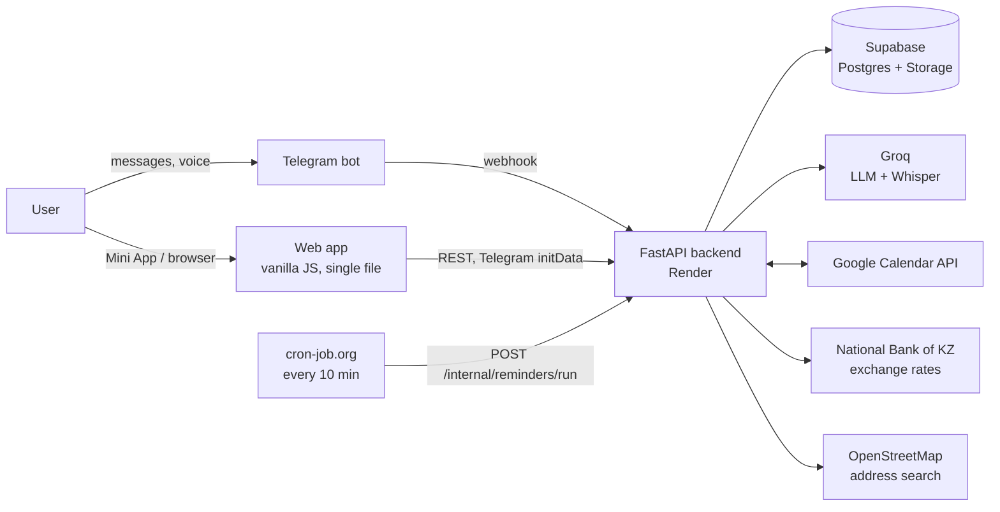

# JulYera Agent

**A personal AI assistant for tasks, notes and money — in Telegram.**
Type or say *"dinner at mom's on Saturday at 7, then buy flowers"* and it becomes structured tasks with dates, steps and
a place on the map. They show up in the Telegram bot, in a mobile web app (a Telegram Mini App) and in Google Calendar.
The same assistant tracks expenses, runs shared to-do lists for a family, and sends morning and evening digests.

*[Русская версия](README.ru.md)*


<p>
  
  
  
  
</p>
<p>
  
  
  
  
</p>

> The app is in Russian (the language of its users). Screenshots show fictional demo data from the local dev server.

## What it does

**Tasks**
- Natural-language input by text or voice (Whisper) → an LLM (Groq) extracts task, date, time range, multi-day spans,
  category, recurrence and place. Relative dates ("next Friday") are resolved in each user's time zone.
- Steps (sub-tasks) with progress: the task completes itself when the last step is ticked. "Break into steps" asks the LLM
  for 3–7 steps.
- Precise recurrence (weekdays, chosen days, monthly on the same date with end-of-month handling, yearly).
- Day strip, calendar, folders, search, filters, archive, swipe actions with undo, read-only task card with an embedded map.

**Google Calendar, both ways** — tasks become events; events (including every occurrence of recurring series, from
several calendars) become tasks. Edits flow in both directions without loops or duplicates.

**Groups** — a page per group ("Family", "Trip with friends") where every task appears for all members. People join by
an invite link in the bot. Each group chooses whether one tick closes a task for everyone or each member ticks their own
("2 of 3 done"). Steps and comments are shared.

**Notes** — checklists, photos, links and places; "tasks from a note" turns a note into tasks you pick.

**Wallet**
- Expenses and incomes from a chat message ("coffee 3.5 euro"), Apple Pay (via an iOS Shortcuts automation) or a form.
- Five currencies with the National Bank of Kazakhstan exchange rates; totals in the user's main currency.
- Category limits with 80% / 100% alerts, analytics, 6-month dynamics, savings goals, a branded PDF statement.
- Recurring payments that are either charged automatically or wait as a "💳 pay" task until ticked.

**Telegram bot** — morning and evening digests, reminders before a task, a weekly review, buttons to complete or snooze,
a weekly JSON backup, release notes after each deploy.

**Access** — sign-in with Telegram; new people are approved by the owner; an admin view for the owner.

## Architecture



One FastAPI service serves the REST API, the Telegram webhook and the static web app. A scheduler calls one protected
endpoint every 10 minutes; it answers immediately (202) and in the background syncs calendars, charges recurring
payments and sends whatever digests are due in each user's time zone.

## Engineering highlights

- **Multi-tenant isolation on a service-role key.** The backend bypasses row-level security, so every query is scoped
  by `user_id` set from the verified session — never from the client. An isolation suite checks every route with two
  users and can also run against the live service with temporary accounts.
- **Telegram authentication.** Mini App `initData` is verified with HMAC and an expiry; browser access uses a personal
  key; strangers can only request access, and the owner approves them from the bot.
- **Idempotent scheduled jobs.** Each digest, reminder, limit alert and release note inserts a log row *before* sending,
  so retries and parallel runs never double-send. Payments advance with conditional updates
  (`… where next_run = <due date>`), so two simultaneous ticks create one transaction.
- **Two-way calendar sync without loops.** JulYera's own events carry a private marker; changes are detected by
  comparing the event's `updated` time with the last write; a unique `(user_id, event_id)` index prevents duplicates;
  an event is deleted locally only on an explicit cancel or 404/410, never because it is missing from a page.
- **Shared tasks as per-user copies.** Each member owns a copy (own calendar, reminders, category); shared fields
  propagate to the copies, while steps and comments live on one canonical copy and move if its owner leaves.
- **Money done right.** `numeric(14,2)` in the database and `Decimal` in Python, no floats; all totals are computed on
  the server and paginated past 1,000 rows; converted amounts are marked as approximate.
- **"Naive" wall-clock deadlines.** Times are stored as the user's local wall time and never shifted through the browser's
  time zone — a whole class of off-by-hours bugs is designed out.
- **Frontend without a build step.** One HTML file with vanilla JS: light and dark themes from design tokens, Telegram
  safe areas, 44 px touch targets, focus restoration after re-renders, optimistic updates with undo, and a cold-start
  loader for the free hosting tier.
- **Additive-only migrations** (16 so far), applied by hand in the Supabase SQL editor.

## Tech stack

| Layer | Technology |
|---|---|
| Backend | Python 3.12, FastAPI, uvicorn, Pydantic |
| Database & files | Supabase (Postgres, Storage) via `supabase-py` |
| AI | Groq: `gpt-oss-120b` for parsing, `whisper-large-v3` for voice |
| Bot | python-telegram-bot (webhook) |
| Integrations | Google Calendar API (OAuth), NBK exchange rates, OpenStreetMap Nominatim, Apple Pay via iOS Shortcuts |
| PDF | ReportLab with Onest / Unbounded fonts |
| Frontend | Vanilla JS + CSS in a single `web/index.html`, Telegram Mini App SDK |
| Hosting | Render (auto-deploy from `main`), cron-job.org for the scheduler |

## Project structure

```
main.py                    REST API, auth, Telegram webhook, scheduler endpoint, static files
telegram_handlers.py       bot commands, buttons, voice and photos
task_service.py            tasks, recurrence, time ranges, calendar hooks
calendar_sync.py           Google Calendar → tasks
google_calendar_service.py tasks → Google Calendar, OAuth
groups_service.py          groups, invite links, permissions
shared_service.py          shared task copies and propagation
folders_service.py         personal and group folders
digest_service.py          digests, reminders, weekly review
money_service.py           wallet: transactions, totals, recurring payments, limits, analytics
goals_service.py           savings goals
statement_service.py       PDF statement
notes_service.py           notes, photos
groq_client.py             LLM prompts, parsing, speech-to-text
web/index.html             the whole frontend
migrations/                SQL migrations 001–016
scripts/                   check suites and an in-memory Supabase fake
design/                    design spec, mockups, local dev server with demo data
```

## Run it locally

The quickest way needs **no keys at all**: the dev server runs the real backend against an in-memory database filled
with demo data (the LLM and Telegram are stubbed).

```bash
python3.12 -m venv .venv
source .venv/bin/activate
pip install -r requirements.txt
python design/dev_server.py
```

Open <http://localhost:8002/?key=test123>.

For a full setup with real services, copy `.env.example` to `.env`, fill in Supabase, Groq, Telegram and Google
credentials, apply `schema.sql` / `migrations/` in Supabase, and run `uvicorn main:app --reload`.

## Checks

There is no test framework; each area has a script that runs the real app against the in-memory database and prints a
checklist — about 640 checks in total:

```bash
python scripts/isolation_check.py   # data isolation between users (also: --base-url https://… for a live service)
python scripts/money_check.py       # wallet, currencies, recurring payments
python scripts/calendar_check.py    # two-way Google Calendar sync (Google stubbed)
python scripts/shared_check.py      # groups and shared tasks
```

## How it was built

Designed and product-managed by me; developed with [Claude Code](https://claude.com/claude-code) as an AI pair
programmer (commits carry a co-author trailer). Every feature started from a mockup I approved, went through the check
suites, and was deployed only after review. [`CLAUDE.md`](CLAUDE.md) is the project's working memory: architecture,
decisions and rules that must not break.

## License

© 2026 Yerassyl Alimkul. All rights reserved. The code is published for viewing as a portfolio project; see
[LICENSE](LICENSE).
