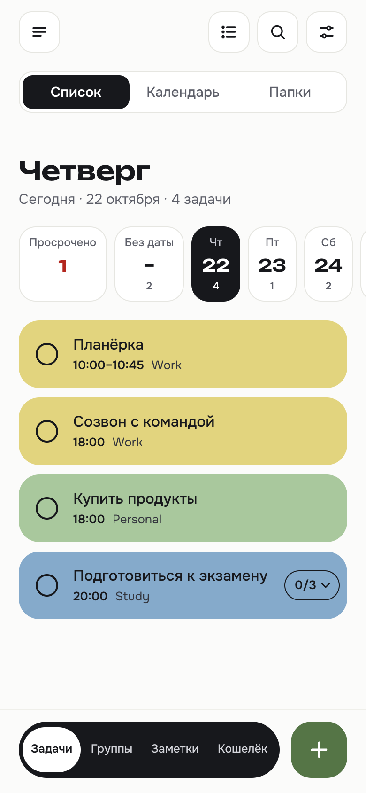
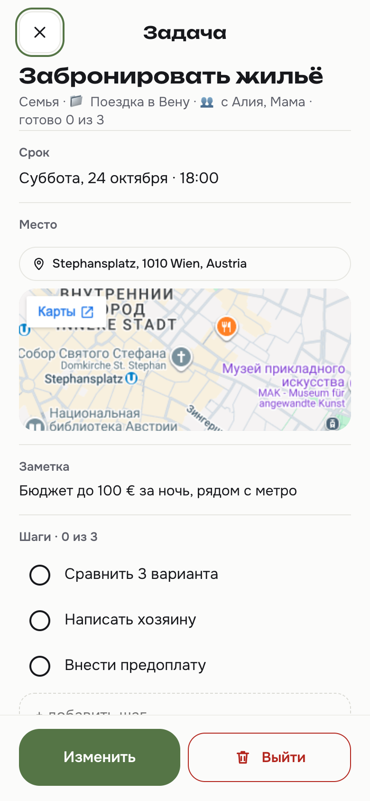
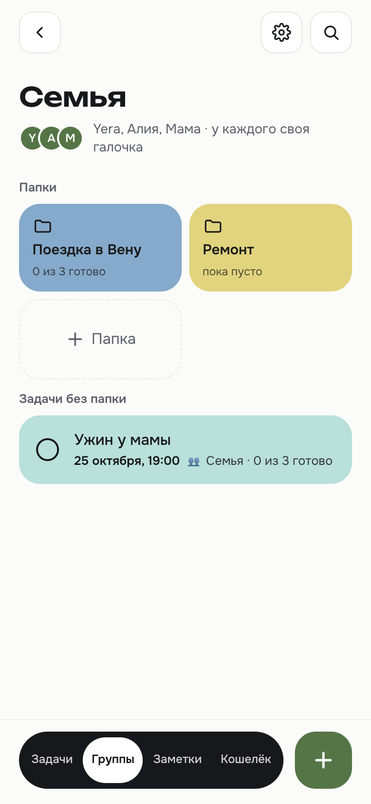
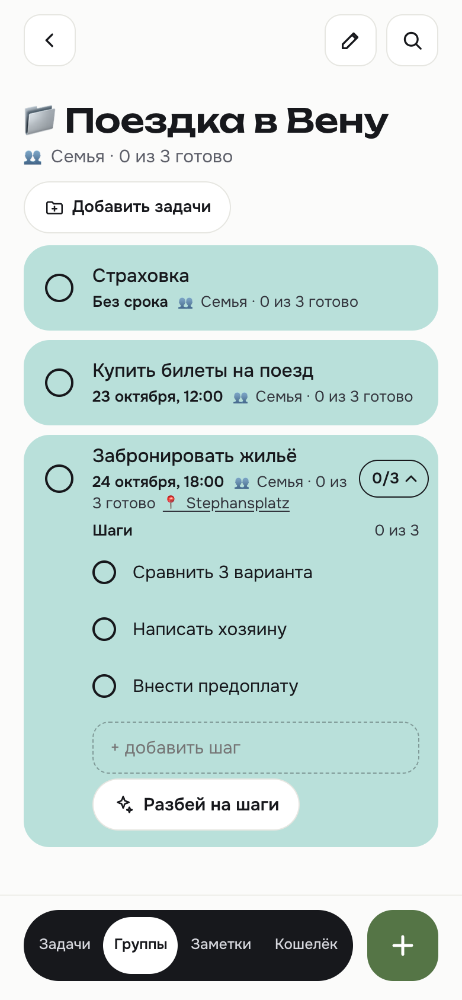
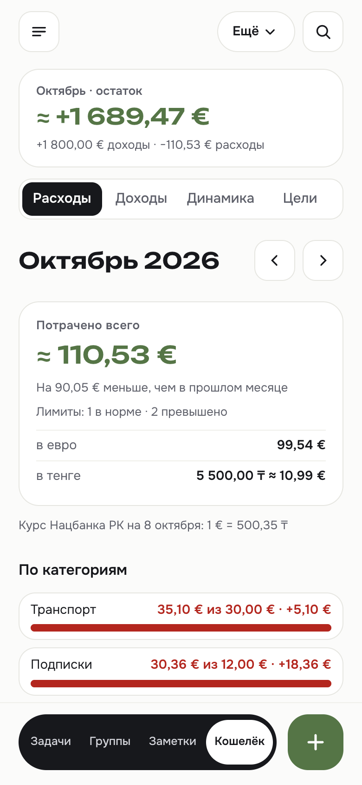
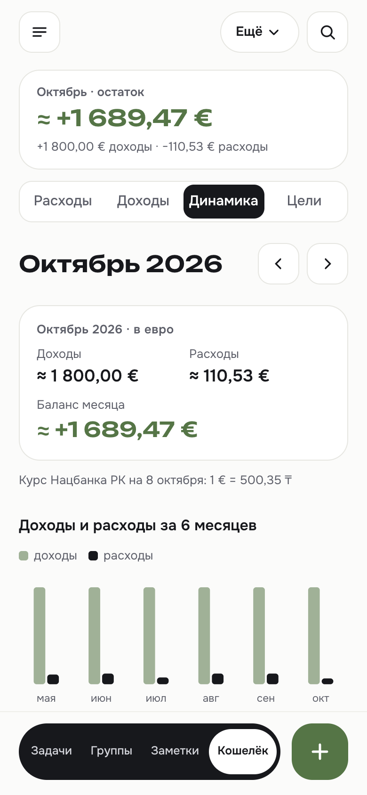
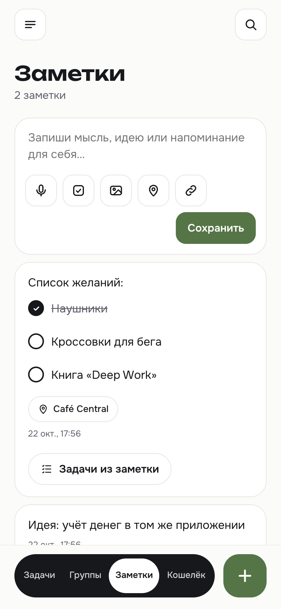
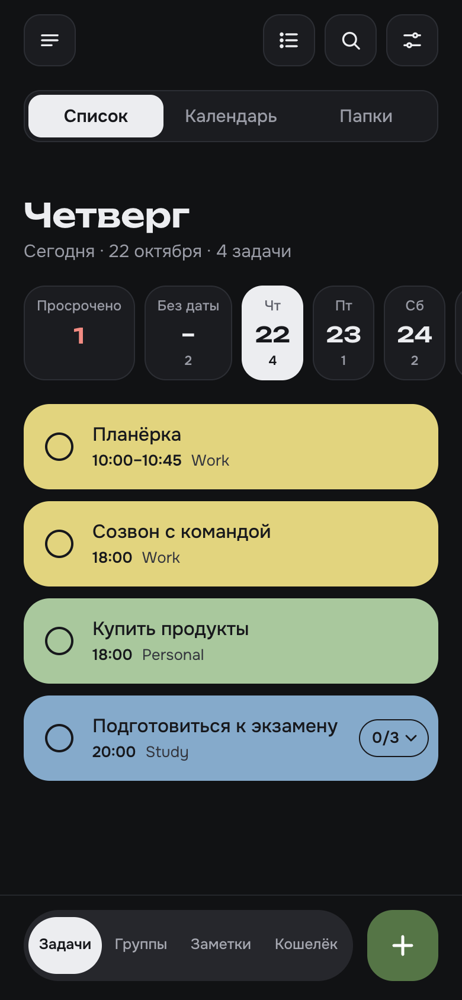
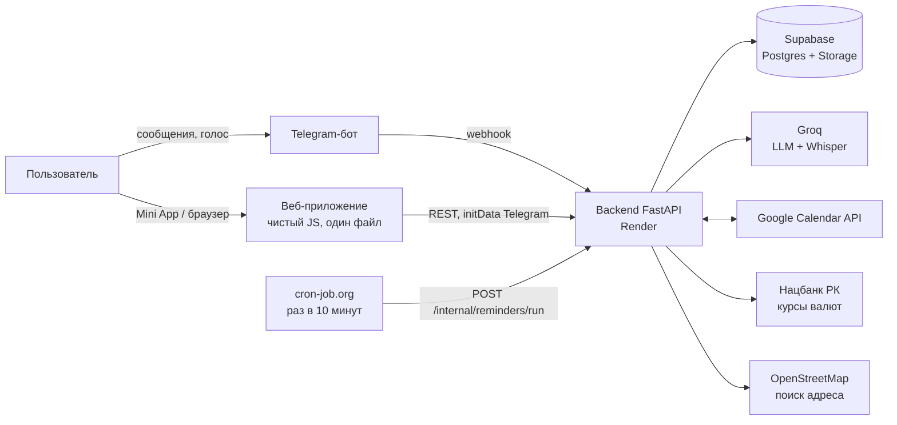

# JulYera Agent

**Личный ИИ-помощник для задач, заметок и денег — в Telegram.**
Пишете или говорите *«ужин у мамы в субботу в 7, потом купить цветы»* — и получаете задачи с датой, шагами и местом на
карте. Они появляются в Telegram-боте, в мобильном веб-приложении (Telegram Mini App) и в Google Calendar. Тот же
помощник ведёт учёт трат, общие списки дел для семьи и присылает сводки утром и вечером.

*[English version](README.md)*

<p>
  
  
  
  
</p>
<p>
  
  
  
  
</p>

> На скриншотах — вымышленные данные с локального тестового сервера.

## Что умеет

**Задачи**
- Ввод обычной речью, текстом или голосом (Whisper): модель Groq достаёт задачу, дату, время «с — до», дни «с — по»,
  категорию, повтор и место. «В следующую пятницу» считается в часовом поясе каждого пользователя.
- Шаги с прогрессом: последняя галочка закрывает задачу сама. «Разбей на шаги» просит у модели 3–7 шагов.
- Точные повторы: по будням, по дням недели, каждый месяц того же числа (с учётом коротких месяцев), каждый год.
- Полоса дней, календарь, папки, поиск, фильтры, архив, свайпы с отменой, карточка задачи с картой.

**Google Calendar в обе стороны** — задачи становятся событиями, события (включая каждое повторение серий, из нескольких
календарей) — задачами. Правки идут в обе стороны без зацикливания и дублей.

**Группы** — у каждой группы («Семья», «Поездка с друзьями») своя страница: задача сразу появляется у всех участников.
Вступают по ссылке-приглашению в боте. Группа сама выбирает, закрывает ли одна галочка задачу у всех или у каждого
своя («готово 2 из 3»). Шаги и комментарии общие.

**Заметки** — списки с галочками, фото, ссылки и места; «Задачи из заметки» превращает заметку в задачи.

**Кошелёк**
- Траты и доходы сообщением («кофе 3,5 евро»), через Apple Pay (автоматизация в «Командах» iPhone) или формой.
- Пять валют по курсу Нацбанка РК; итоги в основной валюте пользователя.
- Лимиты по категориям с предупреждением на 80% и 100%, аналитика, динамика за полгода, цели накопления, выписка PDF.
- Повторяющиеся платежи: списываются сами или висят задачей «💳 оплатить», пока не отметите.

**Telegram-бот** — утренняя и вечерняя сводка, напоминание перед задачей, итоги недели, кнопки «Готово» и «Отложить»,
резервная копия раз в неделю, заметка о новой версии после каждого релиза.

**Доступ** — вход через Telegram; новых людей одобряет владелец; у владельца — раздел администрирования.

## Как устроено



Один сервис FastAPI отдаёт REST API, принимает webhook Telegram и раздаёт веб-приложение. Планировщик раз в 10 минут
вызывает защищённый адрес; тот сразу отвечает (202), а в фоне синхронизирует календари, списывает повторяющиеся платежи
и рассылает сводки, у которых в часовом поясе пользователя подошло время.

## Инженерные решения

- **Изоляция пользователей при ключе service_role.** Backend обходит RLS, поэтому каждый запрос ограничен `user_id`,
  который берётся из проверенного входа, а не от клиента. Отдельный набор проверок гоняет каждый маршрут на двух
  пользователях — локально и против живого сервиса на временных аккаунтах.
- **Вход через Telegram.** `initData` Mini App проверяется по HMAC и сроку; в браузере — личный ключ; незнакомец может
  только попросить доступ, владелец одобряет его кнопкой в боте.
- **Идемпотентные рассылки.** Каждая сводка, напоминание, предупреждение о лимите и заметка о релизе сначала пишет строку
  в журнал, а потом отправляет — повторы и параллельные запуски не шлют дважды. Платежи сдвигаются условным обновлением
  (`… where next_run = <срок>`), так что две одновременные галочки дают одну операцию.
- **Синхронизация календаря без петель.** Свои события JulYera помечены скрытой меткой; изменения видны по времени
  `updated`; уникальный индекс `(user_id, event_id)` не даёт дублей; задача удаляется только при явной отмене события
  или ответе 404/410, а не потому, что его не оказалось на странице выдачи.
- **Общие задачи — копии у каждого участника.** У каждого свой календарь, напоминания и категория; общие поля
  расходятся по копиям, а шаги и комментарии живут на одной главной копии и переезжают, если её владелец выходит.
- **Деньги без float.** `numeric(14,2)` в базе и `Decimal` в Python; все итоги считает сервер, порциями больше
  1000 строк; пересчитанные суммы помечены как приблизительные.
- **Время дедлайна — «голые часы».** Время хранится как время на часах пользователя и никогда не сдвигается часовым
  поясом браузера — целый класс ошибок «на пару часов» исключён устройством.
- **Фронтенд без сборки.** Один HTML-файл на чистом JS: светлая и тёмная темы из токенов, безопасные зоны Telegram,
  кнопки не меньше 44 px, возврат фокуса после перерисовки, мгновенные действия с отменой, экран «сервер просыпается»
  для бесплатного хостинга.
- **Миграции только добавляющие** (сейчас 16), владелец применяет их вручную в SQL-редакторе Supabase.

## Стек

| Слой | Технологии |
|---|---|
| Backend | Python 3.12, FastAPI, uvicorn, Pydantic |
| База и файлы | Supabase (Postgres, Storage) через `supabase-py` |
| ИИ | Groq: `gpt-oss-120b` для разбора текста, `whisper-large-v3` для голоса |
| Бот | python-telegram-bot (webhook) |
| Интеграции | Google Calendar API (OAuth), курсы Нацбанка РК, OpenStreetMap Nominatim, Apple Pay через «Команды» iPhone |
| PDF | ReportLab, шрифты Onest и Unbounded |
| Фронтенд | Чистый JS и CSS в одном `web/index.html`, Telegram Mini App SDK |
| Хостинг | Render (автодеплой из `main`), cron-job.org для расписания |

## Запуск у себя

Быстрее всего — **совсем без ключей**: тестовый сервер запускает настоящий backend на базе в памяти с демо-данными
(модель и Telegram подменены).

```bash
python3.12 -m venv .venv
source .venv/bin/activate
pip install -r requirements.txt
python design/dev_server.py
```

Откройте <http://localhost:8002/?key=test123>.

Для полной установки с настоящими сервисами скопируйте `.env.example` в `.env`, заполните ключи Supabase, Groq,
Telegram и Google, примените `schema.sql` и `migrations/` в Supabase и запустите `uvicorn main:app --reload`.

## Проверки

Каждая часть проверяется своим скриптом: он запускает настоящее приложение на базе в памяти и печатает список
проверок — всего около 640.

```bash
python scripts/isolation_check.py   # изоляция данных пользователей (и --base-url https://… против живого сервиса)
python scripts/money_check.py       # кошелёк, валюты, повторяющиеся платежи
python scripts/calendar_check.py    # синхронизация с Google Calendar (Google подменён)
python scripts/shared_check.py      # группы и общие задачи
```

## Как делался

Продукт, дизайн и решения — мои; код написан вместе с [Claude Code](https://claude.com/claude-code) как ИИ-напарником
(в коммитах указан соавтор). Каждая функция начиналась с макета, который я утверждал, проходила наборы проверок и
выкладывалась только после ревью. [`CLAUDE.md`](CLAUDE.md) — рабочая память проекта: устройство, решения и правила,
которые нельзя ломать.

## Лицензия

© 2026 Yerassyl Alimkul. Все права защищены. Код открыт для просмотра как проект в портфолио, см. [LICENSE](LICENSE).
